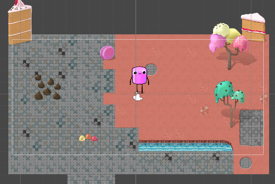

# Robot Repair — Protasyk

Навчальний проєкт Unity.

## Щоденник розробника

### 16.09.2026 — Юніт 1: персонаж і рух
* **Що зроблено:** Налаштовано спрайти підлоги (Tilemap) та персонажа. Створено скрипт `PlayerController`, додано керування за допомогою `Input System` через WASD, стрілочки та стік геймпада.
* **Що не вийшло або забрало найбільше часу:** Виправлення помилок із прив'язкою вектору `MoveAction` в Inspector та первинна синхронізація з веб-гітом.
* **Що зрозумів про Update і Time.deltaTime:** Метод `Update` викликається щокадру, а `Time.deltaTime` дозволяє прив'язати швидкість руху до реального часу (секунд), щоб персонаж рухався однаково на будь-якому ПК.
* **Що робитиму далі:** У Юніті 2 буду налаштовувати фізику (`Rigidbody2D`) та коллайдери для перешкод і стін.
=======
# Robot Repair — Protasyk

Навчальний проєкт Unity.

## Щоденник розробника

### 16.09.2026 — Юніт 1: персонаж і рух
* **Що зроблено:** Налаштовано спрайти підлоги (Tilemap) та персонажа. Створено скрипт `PlayerController`, додано керування за допомогою `Input System` через WASD, стрілочки та стік геймпада.
* **Що не вийшло або забрало найбільше часу:** Виправлення помилок із прив'язкою вектору `MoveAction` в Inspector та первинна синхронізація з веб-гітом.
* **Що зрозумів про Update і Time.deltaTime:** Метод `Update` викликається щокадру, а `Time.deltaTime` дозволяє прив'язати швидкість руху до реального часу (секунд), щоб персонаж рухався однаково на будь-якому ПК.
* **Що робитиму далі:** У Юніті 2 буду налаштовувати фізику (`Rigidbody2D`) та коллайдери для перешкод і стін.

### ДД.ММ.РРРР — Юніт 2: оточення і фізика
Що зроблено: ...
Що не вийшло або забрало найбільше часу: ...
Що зрозумів про FixedUpdate і колайдери: ...
Що в рівні вийшло не так, як у фізичному паспорті, і чому: ...
Що робитиму далі: ...
План гри 

### 01.10.2026 — Юніт 3: оточення і фізика
* Що зроблено: Налаштував Rigidbody2D, колайдери та рух персонажа.
* Що не вийшло: Персонаж спочатку тремтів і проходив крізь перешкоди.
* Що зрозумів: FixedUpdate використовується для фізики, а Collider відповідає за зіткнення.
* Що вийшло не так: Персонаж обертався через налаштування Rigidbody2D.
* Що робитиму далі: Перевірю всі колайдери та зіткнення на рівні.

### ДД.ММ.РРРР — Юніт 3: система здоров'я
**Що зроблено:**
- Додано поля `maxHealth`, `currentHealth` та властивість `health` (read-only) у `PlayerController`.
- Реалізовано метод `ChangeHealth(int amount)` із використанням `Mathf.Clamp`.
- Створено префаб аптечки `HealthCollectible` з тригером. Аптечка підбирається тільки за неповної кількості HP.
- Створено префаб зони шкоди `DamageZone` з використанням `OnTriggerStay2D`.
- Налаштовано режим `Never Sleep` у Rigidbody 2D персонажа.
- Реалізовано механіку тимчасової невразливості (`timeInvincible`, `isInvincible`, `damageCooldown`) після отримання шкоди.
- Выполнено 2 пункта из раздела «More things to try».

### ДД.ММ.РРРР — Юніт 4: система здоров'я
**Що зроблено:**
Додав систему здоров'я робота: `maxHealth`, `currentHealth` та функцію `ChangeHealth()`. Додав аптечки, які відновлюють здоров'я, і зону шкоди, яка його забирає. Налаштував невразливість після отримання шкоди.**Що не вийшло або забрало найбільше часу:**
Найбільше часу забрало налаштування зони шкоди. Спочатку `OnTriggerStay2D` забирав здоров'я занадто швидко, тому додав паузу невразливості після удару.
**Що зрозумів про тригери, public і private:**
Тригер дозволяє визначати взаємодію об'єктів без фізичного зіткнення. `public` дозволяє звертатися до змінної з інших скриптів, а `private` не дозволяє змінювати її напряму з інших скриптів. Властивість `health` дозволяє отримувати поточне здоров'я.
**Яке значення Time Invincible обрав і чому:**
Обрав `Time Invincible = 1.5` секунди. Цього достатньо, щоб робот не отримував шкоду багато разів підряд і мав час вийти із зони небезпеки.
**Що робитиму далі:**
Перевірю роботу системи здоров'я та продовжу розробку гри.
